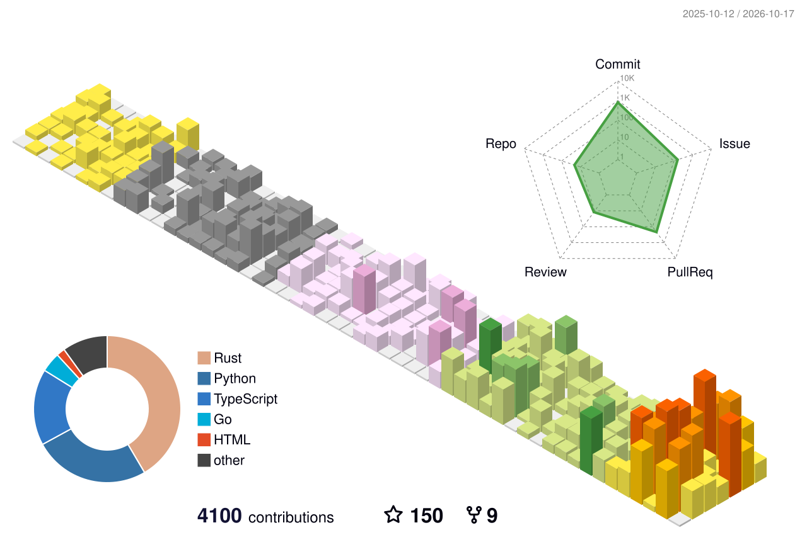

  

---

## About Me - Xingqiu Xu

一个喜欢把系统跑起来、把问题拆清楚的开发者。

- 目前就读于 SYUCT
- 主要关注AI Agent、后端开发、Linux、云原生与基础设施方向
- 常用 Python / Go / Java 做服务端开发，也会折腾 Rust 和 C/C++
- 对开源项目、工程效率和可靠性建设保持长期兴趣

## GitHub Activity

  <picture>
    <source media="(prefers-color-scheme: dark)" srcset="./profile-3d-contrib/profile-night-rainbow.svg">
    <source media="(prefers-color-scheme: light)" srcset="./profile-3d-contrib/profile-season-animate.svg">
    
  </picture>

## Tech Stack

### Languages

### Frameworks & Tools

### Databases & Cloud

---
